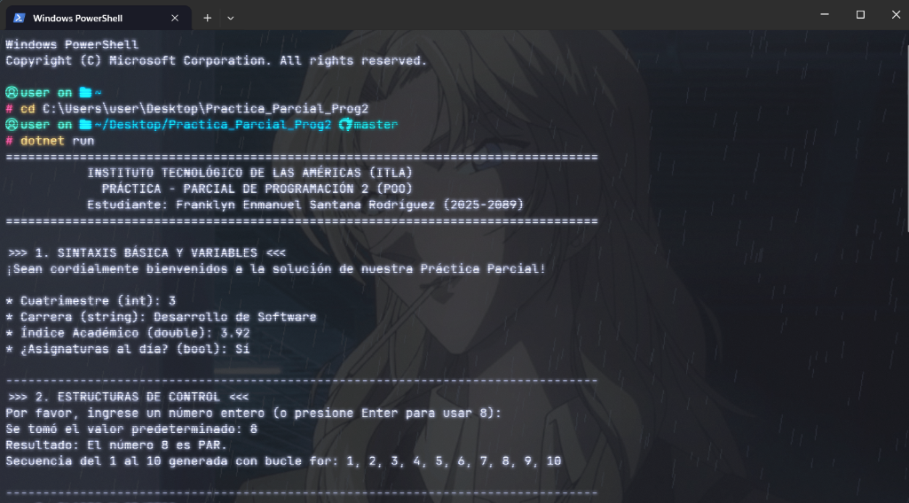
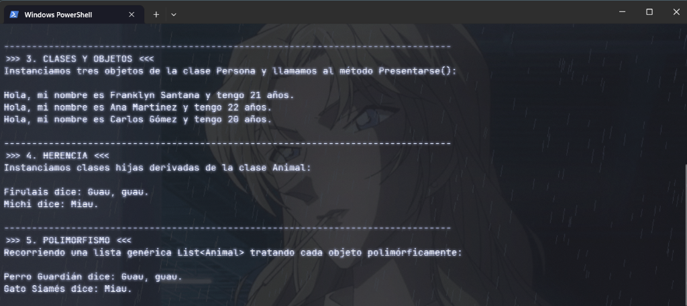
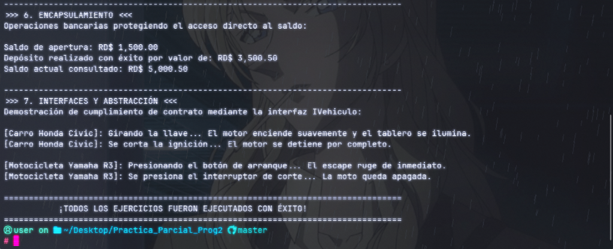

# Práctica - Parcial: Programación Orientada a Objetos en C#

**Institución:** Instituto Tecnológico de Las Américas (ITLA)  
**Asignatura:** Programación 2  
**Docente:** Eduandy Isabel Cruz Abreu  
**Estudiante:** Franklyn Enmanuel Santana Rodríguez (Matrícula: 2025-2089)  
**Modalidad:** Proyecto Individual (Autorizado por la docente)  

---

## 📌 Descripción del Proyecto
Este repositorio contiene la solución completa de la **Práctica - Parcial** de Programación 2, estructurada en un solo proyecto de consola en C# (.NET). El código fuente se encuentra debidamente documentado con comentarios técnicos que explican la sintaxis y los cuatro pilares fundamentales de la Programación Orientada a Objetos (POO): **Abstracción, Encapsulamiento, Herencia y Polimorfismo**, además de la implementación de **Interfaces**.

---

## 🛠️ Contenido de los Ejercicios Desarrollados

### 1. Sintaxis Básica y Variables
* Mensaje formal de bienvenida al sistema con identificación del estudiante.
* Declaración, asignación e impresión de distintos tipos de datos primitivos (`int`, `string`, `double`, `bool`).

### 2. Estructuras de Control
* Evaluación condicional con operador módulo (`%`) para determinar si un número introducido es par o impar.
* Manejo de entrada interactiva y uso de un bucle `for` para iterar y mostrar los números del 1 al 10.

### 3. Clases y Objetos
* Definición de la clase `Persona` con propiedades para el nombre y la edad.
* Método `Presentarse()` que expone formalmente los datos de la instancia.
* Creación de tres instancias de la clase en el método principal `Main()`.

### 4. Herencia
* Creación de la clase base `Animal` que provee el método virtual `HacerSonido()`.
* Implementación de las clases derivadas `Perro` y `Gato`, heredando las características de la clase base y redefiniendo su sonido característico.

### 5. Polimorfismo
* Uso de colecciones genéricas con `List<Animal>`.
* Recorrido de la lista mediante un ciclo `foreach`, invocando polimórficamente `HacerSonido()` para que cada objeto ejecute su comportamiento especializado.

### 6. Encapsulamiento
* Creación de la clase `CuentaBancaria` con atributo privado `saldo`.
* Implementación de métodos públicos `Depositar(decimal monto)` y `ObtenerSaldo()`, garantizando la validación de montos positivos y la protección del estado interno.

### 7. Interfaces y Abstracción
* Definición del contrato formal `IVehiculo` con los métodos `Encender()` y `Apagar()`.
* Implementación en las clases `Carro` y `Motocicleta`, exhibiendo comportamientos diferenciados en consola.

---

## 📷 Evidencias de Ejecución

El programa fue compilado y ejecutado satisfactoriamente desde la terminal mediante el comando `dotnet run`:

### Parte 1: Sintaxis Básica, Variables y Estructuras de Control (Ejercicios 1 y 2)


### Parte 2: Clases, Objetos, Herencia y Polimorfismo (Ejercicios 3, 4 y 5)


### Parte 3: Encapsulamiento, Interfaces y Abstracción (Ejercicios 6 y 7)


---

## 🚀 Cómo Ejecutar el Proyecto

```bash
# 1. Clonar el repositorio
git clone https://github.com/Osiris3939/Practica_Parcial_Prog2.git

# 2. Entrar a la carpeta
cd Practica_Parcial_Prog2

# 3. Ejecutar la aplicación
dotnet run
```
